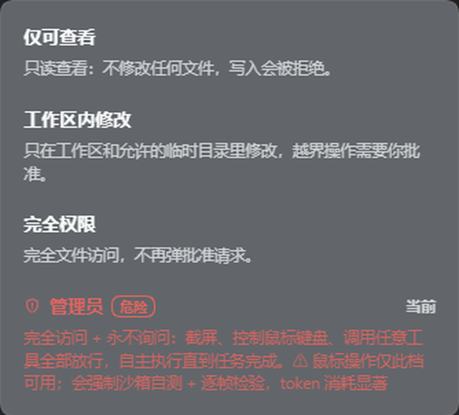

# DSH 管理员模式（dsh-admin-mode）

把「完全访问 + 永不询问」做成 DSH 里的一个权限档，并**自带官方 computer use**、
屏幕操作 HUD 和「自主迭代」按钮。



---

## 里面有什么

### 1. 管理员权限档

- 在输入框的**权限菜单**里新增一档 **「管理员」**（红色警示 + 「危险」徽章）
- 效果 = `danger-full-access` + `approval: never`：
  **截屏、鼠标、键盘、任意工具全部放行，不再弹批准请求**，可以一直自主执行到任务完成
- ★ **无沙箱**：`danger-full-access` 让 DSH 的文件与命令执行脱离沙箱限制
- 选择时**连续弹两次严重警告**，每次都必须勾选确认才能继续
- 权限菜单一共 4 档（官方 `auto` 档在本插件里隐藏，不提供）：
  `仅可查看` → `工作区内修改` → `完全权限` → `管理员`

### 2. 自主迭代按钮

输入框工具行上的 **↻** 按钮（宽窗口显示「↻ 迭代」）：

- 填「迭代方向」+「迭代次数」，一键让 AI **自主连续迭代 N 轮**
- 每轮都会带着方向重新开工，直到次数用完
- 窄窗口自动收成 26px 圆钮，不占地方

### 3. 内置官方 computer use（**不需要另外装**）

- bundle patch 里直接 `insert` 两个**官方**插件：
  - `@deepseek-ai/dsh-computer-use`
  - `@deepseek-ai/dsh-experimental-computer-use-cua-driver-native`
- 版本固定 `0.2.2-rc.1`（与当前 DSH 运行时 `0.2.2-rc.1` 一致，两个包都是 npm 公开包）
- 历史：`0.2.1-rc.5` → `0.2.2-rc.1` 只改了 `peerDependencies` 里的 `dsh-brand` 版本，
  两个包的 `lib/index.js` 逐字节相同，所以升级是纯元数据修复，没有行为变化要重新审
- 版本必须与运行时一致：包的 `peerDependencies` 里锁了 `@deepseek-ai/dsh-brand@0.2.2-rc.1`，
  版本不匹配会被启动兼容闸直接拒载（插件行静默变成 `enabled:false`，界面上看不出原因）
- 还会注入一条系统提示：**操作电脑时优先用 computer use 工具直接操作屏幕**，
  而不是写脚本模拟鼠标键盘

### 4. 操控提示

- 鼠标操作期间，**消息流里**（对话末尾，像一条消息）显示「正在操控电脑」；操作停止后自动消失
- 判据：鼠标工具调用会刷新操作状态，**30 秒内有过鼠标操作就持续显示**，
  连续操作、中间思考几秒都不会中断
- 按 **ESC**：立刻隐藏并暂停显示 3 秒
- **零外部依赖**：前端 DOM + `/admin-mode/hud` 只读状态路由

### 5. `auto` 档（自动审查）：不提供

- DSH 官方有一档 `auto`（无沙箱 + 每次工具调用前审查，EXP）；本插件把它从权限菜单里**隐藏**
- 原因：实测 `auto` + `never`（永不询问）= 审查拒绝即静默拒绝，**所有工具调用都会被拦死**，
  连只读命令都无法执行；配 `ask` 又违背「管理员档永不询问」的定位
- 所以 `auto` 不再出现在菜单里；如果当前会话正处在 `auto`（例如用 `/permission auto` 切的），
  按钮上仍会显示它的名字，只是菜单不提供这一项

---

## 6. 鼠标门控 + 管理员档工作规范（v1.0.0 内建）

### 只有「管理员」档能操作鼠标

- **默认拒绝**：所有 `cua_driver_native__*` 工具（当前 CUA SDK 共 56 个）在**非管理员档**下由
  Host 侧 `tools.guard()` 拒绝（不弹批准、不执行），报错里会带上当前档位名
- **只读白名单**：`get_window_state` / `list_windows` / `list_apps` / `screenshot` / `zoom` /
  `get_accessibility_tree` / `get_screen_size` / `get_desktop_state` / `get_cursor_position` /
  `clipboard_read` / `health_report` / `check_permissions` 以及会话句柄类
  （`start_session` / `get_session` / `list_sessions` / `get_session_state` / `end_session`）
  在**任何档位**都放行 —— 截屏要先 `start_session`，全禁会把「看一眼」也堵死
- **键盘、剪贴板、进程、窗口改名**都算门控项：`type_text` / `press_key` / `hotkey` /
  `clipboard_write` / `launch_app` / `kill_app` / `bring_to_front` / `set_window_frame` /
  `browser_*` 写入类，全部只在「管理员」档放行
- 判据来自 `exec.agent.session` 的当前 preset；拿不到会话就当作「未知」→ **拒绝**（fail-safe）
- 2026-11-04 在 0.2.1-rc.5 真实宿主里实测：`cua_driver_native__*` 共 56 个工具入表，
  `type_text` / `click` / `hotkey` / `launch_app` 被拒，`get_window_state` / `list_apps` 放行
- 2026-11-07 在 0.2.2-rc.1 真实宿主里复核：工具数仍是 56（Cua Driver SDK 仍是 0.28.0），
  管理员档下 `mouseGuardAllow=cua_driver_native__click @ admin`，非管理员档照旧拒绝
- 想用鼠标 → 切到「管理员」档

### 门控怎么自查（诊断文件里的字段）

诊断文件（路径见「交付门槛」一节）里与门控有关的行：

| 字段 | 含义 |
| --- | --- |
| `mouseGuardRegistered=ok` | `tools.guard()` 真的注册上了（=fail 说明宿主拒绝，通常是 `inject` 没写 `tools`） |
| `mouseGuardCalls=<n>` | guard 被问过的次数 |
| `mouseGuardLast=<工具名>` | 最近一次被问的工具全名 |
| `mouseGuardDeny=<工具名> @ <档位>` | 真的拦了：哪个工具、当时是哪一档 |
| `mouseGuardAllow=<工具名> @ admin` | 管理员档放行的 cua 工具 |

> 只有 cua 工具、以及每次 apply 后的第一次调用会写盘，普通工具（`ops_bash` / `read` …）
> 不会每次都写文件 —— 否则 guard 每被问一次就同步落一次盘。

`mouseGuardLast=ops_bash` 是正常的：guard 对所有工具都会被问，只是非 cua 工具直接放行。

### 鼠标必须滑动

- 系统提示要求：移动光标用多次 `move_cursor` 分步滑动，每步不超过屏幕宽高的 1/6，通常 3~6 步到位；
  **禁止一步跳到目标再点**
- 能点/能滑的操作优先用 computer use，**不用脚本模拟鼠标键盘**；脚本只留给文件处理、构建、渲染等非 UI 任务

### ★ 操作桌面时优先用 UIA，不要靠截图估坐标

**这是「慢」的根因，也是本插件维护时最容易走歪的地方。**

`cua_driver_native__get_window_state` 对 Electron 只返回最小化/恢复/关闭三个按钮，
但这**不代表**系统 UIA 拿不到页面元素 —— 它只是 MCP 那层做的精简投影。
直接查 UI Automation：

```python
import uiautomation as auto
root = auto.GetRootControl()          # 找标题含 "Harness" 的窗口
# 一次能遍历到 574~603 个元素，全部带名字：
#   Button '访问模式，当前：管理员'              (1018, 1338)
#   Edit   '发消息或创建任务, / 调用指令, @ 文件或对话'  (1414, 1290)
#   Button '↻'                                (1088, 1338)
```

| 做法 | 一轮交互 | 可靠度 |
| --- | --- | --- |
| 截图 → 看降采样图估坐标 → 点错 → 重来 | 30~90 s | 低（连续点错 3 次是常态） |
| UIA 按名字取坐标 → 直接点 | **1.4~2.6 s** | 高 |

现成工具在 `D:\Vibe coding\plugin\dsh-admin-mode-fix2\tools\`：

```
python ui.py find 访问模式          # 查坐标（首选，最快）
python ui.py click 访问模式         # 按名字点
python ui.py list --min-y 900      # 列出输入区所有控件
python ui.py wait 严重警告          # 等弹窗出现
powershell ... uia.ps1 -Find 访问模式   # 无 Python 环境时的等价物
powershell ... ui.ps1  -Find 某段文字   # UIA 拿不到的 canvas 区才用 OCR
```

**判断通道能不能用时，不要拿封装工具的行为当结论**：`get_window_state` 不给元素
≠ 系统 UIA 不给元素。真验证要用底层 API 直接试一次。

### 管理员档的工作要求（tokens 不设限）

1. 必须在沙箱里把改动真跑一遍（真实点击、输入、截图验证），不许只改代码就宣布完成
2. UI / 动画 / 视觉改动必须**逐帧检验**（连续截多帧对比，确认无错位、穿模、闪烁）
3. 必须**完全符合用户需求**才算完成，不确定就继续测
4. 完成后如果有产出（图片、视频、文档、压缩包、exe），**自动打开所在文件夹并选中该文件**
   （Windows: `explorer /select,<路径>`）
5. 管理员档 token 消耗明显更高 —— 权限菜单和两次警告里都标了 **tokens 警告**

### ★ 交付门槛（硬性，避免"聊天框失效"这类事故）

- **没自己实测通过，不许告诉用户可以用了**；用户只做最后验收
- UI / 插件类改动，必须**重启后**在真实界面里逐项确认：
  聊天框能打开、能输入文字、能发送、消息与回复正常显示、权限菜单能打开并切换、
  页面不白屏、不卡在启动页
- **插件自带 UI 自检**：client 加载后 1.5s / 4s / 8s 探测三次聊天输入区，
  连续三次都拿不到 composer 才**熔断视觉层**（屏幕提示 overlay），
  **权限菜单控件本身永不熔断** —— 早期版本把「控件」和「overlay」共用一个开关，
  开机探测一旦抢先失败就把权限菜单永久藏掉（就是「权限选择没了」那次事故）
- 自检结果 POST 到 `/admin-mode/selftest`，落进诊断文件（`uiSelfTest=ok/fail`）
- ★ **绝对不要在正在干活的会话里降档验证切档效果**：门控看的是「当前 exec 所属会话」的档位，
  一旦把自己切到 read-only，鼠标/键盘/文件写入会同时失效，而且**没法自己点回来**。
  要测切档，开一个新会话去测。真踩了坑的判断依据是诊断文件的
  `mouseGuardAllow … @ <preset>` 行 —— 这时 UIA 树可能已经塌缩（Chromium 收起无障碍树，
  `ElementFromHandle(...).FindAll()` 只剩 2 个元素），别再指望它。
- 诊断文件按 **profile + pid** 分文件，避免多个 profile / 多个进程互相覆盖：
  `%TEMP%\dsh_admin_mode_diag.<profile>.<pid>.txt`，同时把最新一份另存为
  `%TEMP%\dsh_admin_mode_diag.txt.latest`（末尾带 `profile=` / `pid=`）

---

## 安装

> 需要 **DSH 桌面端**（Electron），并且 DSH 运行时版本与依赖里的 `0.2.2-rc.1` 一致。
> 升级 DSH 之后如果 computer use 忽然不见了，先查两件事：依赖版本是否跟着升了、
> `node_modules` 里装的是不是新版本（`pnpm install` 完之后要重启桌面端才生效）。

### 方法 A：插件管理器（推荐，如果你的 DSH 有这一页）

1. 解压压缩包，得到 `dsh-admin-mode/` 目录（里面有 `package.json`）
2. DSH 左侧「插件」页 → 安装本地插件 → 选这个目录
3. 重启 DSH

### 方法 B：手工安装（Windows）

1. 解压到例如 `D:\dsh-admin-mode\`
2. 打开 `%USERPROFILE%\.dsh\profiles\<你的profile>\package.json`（一般是 `desktop`）
3. `dependencies` 里加一行：
   ```json
   "@local/dsh-admin-mode": "file:D:/dsh-admin-mode"
   ```
4. `dsh.profile.bundles` 数组里加 `"@local/dsh-admin-mode"`
5. 在 `node_modules\@local\` 下建一个 **Junction**（目录联接）：
   ```
   mklink /J "%USERPROFILE%\.dsh\profiles\desktop\node_modules\@local\dsh-admin-mode" "D:\dsh-admin-mode"
   ```
6. **重启 DSH**（关掉窗口重新打开）

### 装完一定要确认：安装副本是不是真的指向源码目录

这一步**不能省**。`file:` 依赖在部分 pnpm 配置下会退化成「复制」，
或者只把 `package.json` / `README.md` 这类文件做硬链接，`index.js`、`client.js`
仍然是各自独立的副本。这时你改源码目录、宿主读的却是旧副本，
现象是「代码明明改了，界面/行为一点没变」。

```bash
# 1) 是不是联接（Windows 下应该显示 <JUNCTION> 或 <SYMLINKD>）
dir /AL "%USERPROFILE%\.dsh\profiles\desktop\node_modules\@local"

# 2) 关键文件是不是同一份（Git Bash；两行都应为 SAME）
cmp -s <源码目录>/index.js  <安装目录>/index.js  && echo SAME || echo DIFF
cmp -s <源码目录>/client.js <安装目录>/client.js && echo SAME || echo DIFF
```

如果不是 `SAME`，把安装副本整个删掉再建 Junction（不要只删其中几个文件）：

```bash
rm -rf "%USERPROFILE%\.dsh\profiles\desktop\node_modules\@local\dsh-admin-mode"
mklink /J "%USERPROFILE%\.dsh\profiles\desktop\node_modules\@local\dsh-admin-mode" "D:\dsh-admin-mode"
```

改成 Junction 之后，改源码目录 = 改运行中的插件，
之后只需要 `plugin_manager` 里把这一行关掉再打开（或重启桌面端）就会重新加载。

安装成功后：
- 输入框权限菜单里多出「管理员」
- 工具行多出 **↻** 按钮
- 让 AI「打开记事本写一句话」能看到屏幕 HUD

> ⚠ DSH 的 `desktop` profile 由 Electron 独占管理，`dsh plugin install` 可能会报
> `profile "desktop" is managed exclusively by the Electron application` —— 那就用方法 B。

### 卸载

把第 3~5 步加的东西删掉，重启 DSH 即可。

---

## 安全提示

- 「管理员」档 = **完全文件访问 + 永不询问**，请只在你信任的任务里用
- computer use 是官方 **experimental** 原生驱动，与 DSH 同进程运行，原生崩溃可能带崩 DSH
- 操控提示只是视觉提示，不改变权限行为

---

## 结构

```
package.json         插件清单（依赖 + bundle patch + 客户端入口）
index.js             Host 半：鼠标门控（guard）+ 系统提示 + /admin-mode/hud 状态路由
client.js            Client 半：权限菜单（含两次警告）+ 自主迭代按钮 + 操控提示
cordis.patch.yml     插入权限预设、官方 computer use、客户端控件
locale/*.json        插件元数据（中/英）
icon.svg             插件图标
docs/preview.png     界面预览
CHANGELOG.md         维护记录（每次改动为什么改）
```

## License

MIT
